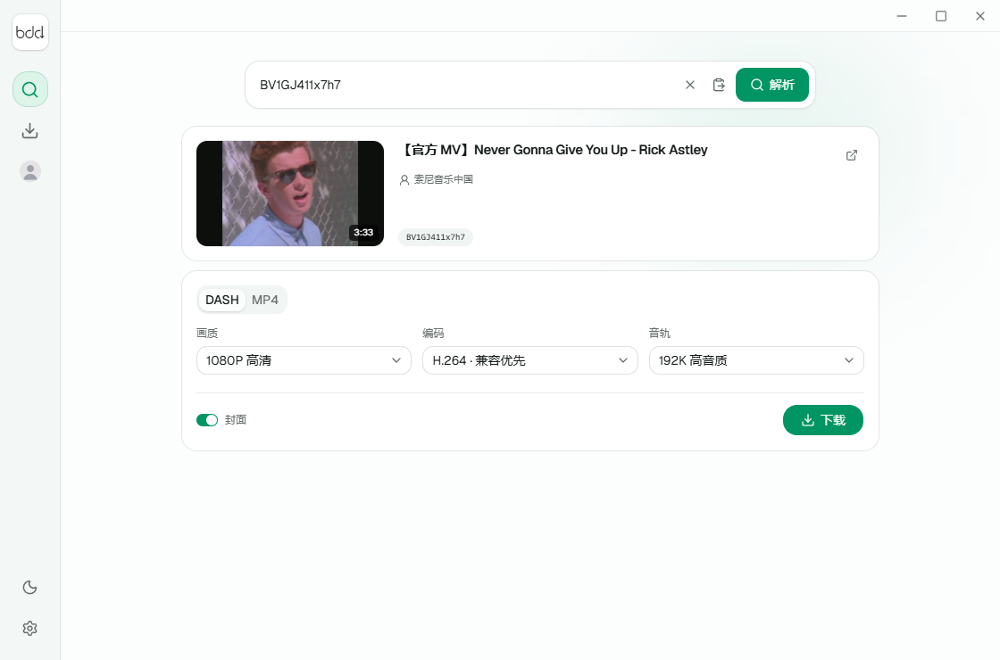
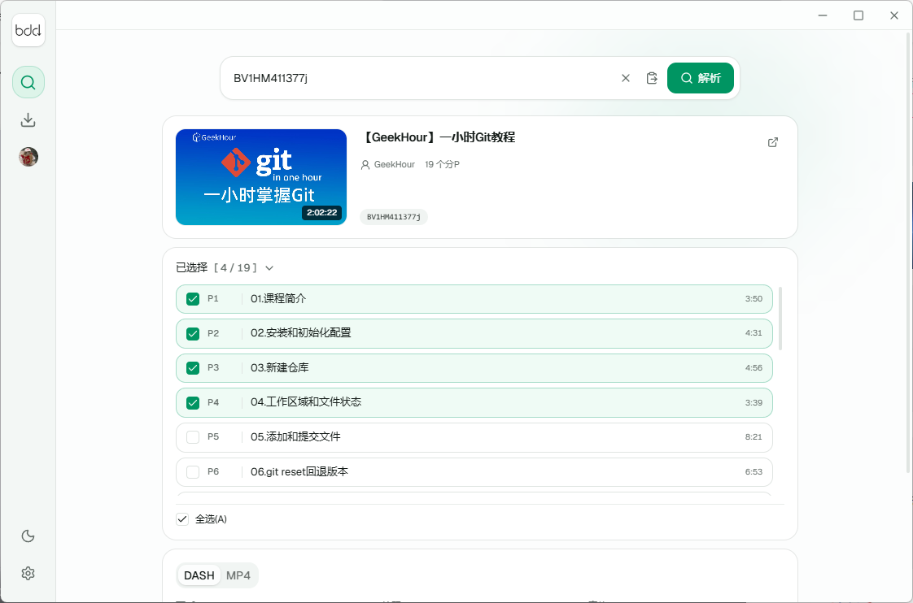
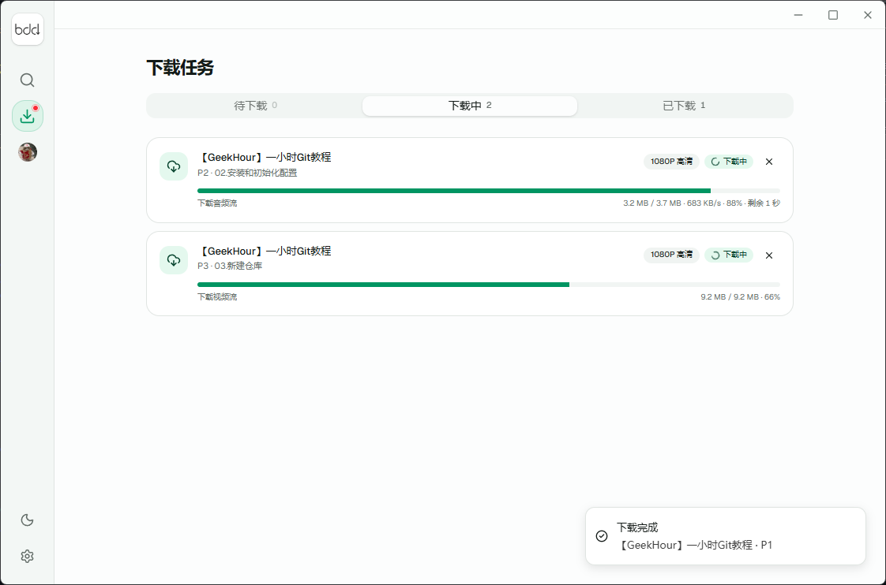
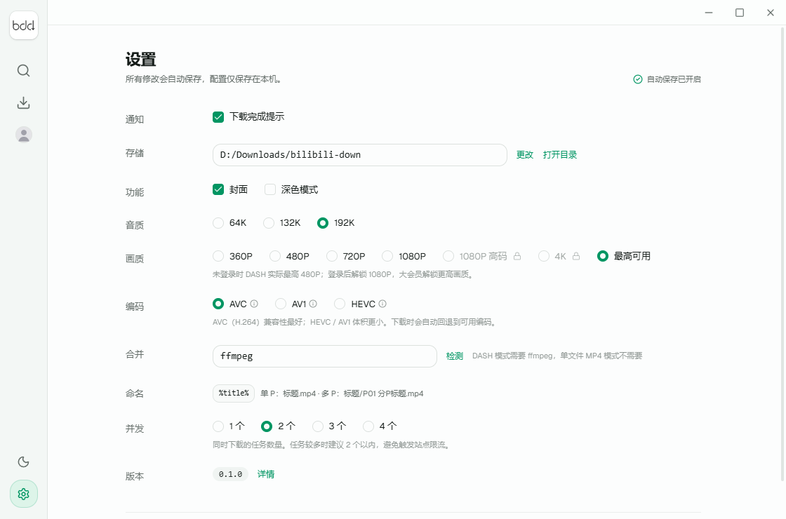

<p align="center">
  
</p>

<h1 align="center">BiliDown</h1>

<p align="center">
  简洁的哔哩哔哩视频下载器 · Tauri 2 + React 19
</p>

<p align="center">
  
  
  
  
  
  
  
</p>

> 一个基于 **Tauri 2** 的桌面端哔哩哔哩视频下载器。粘贴链接即可解析视频与分 P，支持 DASH 音视频合并、单文件 MP4、批量选择、下载队列与扫码登录。
>
> ⚠️ 仅供个人学习与备份使用，请遵守《哔哩哔哩用户协议》与著作权法。

## 界面预览

| 首页解析 | 分 P 批量选择 |
| :---: | :---: |
|  |  |

| 下载任务 | 设置 |
| :---: | :---: |
|  |  |

> 截图中的账号头像、下载路径与任务数据均已脱敏处理。

## 功能

- **链接解析**：支持 BV 号、av 号、`b23.tv` 短链和完整视频链接。
- **分 P 批量下载**：复选框列出全部分 P，支持全选（快捷键 `A`）和批量入队。
- **真实画质**：读取 DASH 实际可用码流，可选画质、编码（H.264 / H.265 / AV1）和音轨。
- **下载内容可选**：解析后可按需选择下载「视频」「音频」「封面」：
  - `视频`：按所选模式下载完整音视频并合并为 MP4。
  - `音频`：只取 DASH 音轨，用 ffmpeg 无损封装为 M4A；没有 ffmpeg 时直接保留原始音频容器。
  - `封面`：只保存该视频的封面 JPG，不请求播放地址。
- **两种下载模式**：
  - `DASH`：分别下载视频流与音频流，使用 ffmpeg 无损合并为 MP4。
  - `单文件 MP4`：适合没有 ffmpeg 的环境，匿名最高 720P。
- **任务管理**：待下载 / 下载中 / 已下载三栏，实时进度、速度、剩余时间、取消与打开文件夹；同一视频的分 P 合并为一张卡片，点击后在同一盒子内展开：可选「完整（带封面）/ 简洁（纯文字，高度约为主卡一半）/ 栅格（纯文字多列）」三种分 P 展示方式，选择会保存在本地。
- **并发控制**：同时下载数可在设置中调整为 1–4 个，超出部分显示「排队中」。
- **扫码登录**：B 站二维码登录，登录后可获取 1080P；大会员支持更高画质。
- **完成提醒**：下载结束显示 Toast 并可选响铃（通知栏可开关，支持试听）。
- **桌面体验**：无边框窗口、左侧栏布局、深浅主题、设置自动保存。

## 技术栈

| 层 | 技术 |
| --- | --- |
| 桌面壳 | Tauri 2 |
| 前端 | React 19、TypeScript、React Router 7、Zustand 5 |
| UI | shadcn/ui（Base UI）、Tailwind CSS 4、Lucide |
| 后端 | Rust、reqwest（rustls）、tokio、md5（WBI 签名） |
| 媒体处理 | ffmpeg（`-c copy` 合并 / concat） |
| 包管理 | pnpm |

## 快速开始

### 环境要求

- Node.js ≥ 20、pnpm
- Rust stable
- Windows 需 WebView2（Windows 11 自带）
- DASH 模式需要 [ffmpeg](https://ffmpeg.org/)；也可以只使用单文件 MP4 模式

### 开发运行

```bash
# 在项目根目录
pnpm install
pnpm tauri dev
```

### 构建

```bash
pnpm build          # 类型检查 + 前端打包
pnpm tauri build    # 生成安装包（src-tauri/target/release/bundle）
```

### 测试

```bash
cd src-tauri
cargo test
```

真实接口与下载集成测试默认忽略，需要网络和 ffmpeg：

```bash
cargo test --test api -- --ignored --nocapture --test-threads=1
```

## CI/CD

流水线全部使用 GitHub Actions，包管理为 pnpm（`pnpm install --frozen-lockfile`）。

| 触发条件 | 流程 | 结果 |
| --- | --- | --- |
| 推送到 `dev` | `.github/workflows/ci.yml` | 前端 typecheck + 构建；Rust `fmt` / `clippy` / `test`（Ubuntu 22.04 + Windows） |
| 推送到 `main` | 同上 | 同上（只做检查与测试，不打包） |
| 推送到标签 `v*` | `.github/workflows/release.yml` | 先跑完全部检查 → 从标签 commit 打包 Windows（MSI / NSIS）与 Linux（deb / AppImage / rpm），上传到 **draft** Release → 两个平台都成功后才发布（原子发布） |

说明：

- Release 发布前会校验标签指向 `main` 上的提交，并且必须是 `vMAJOR.MINOR.PATCH` 形式；不满足直接失败，不会产出安装包。
- 发布说明（Release notes）直接取该标签 commit 的提交信息（`git log -1 --pretty=%B`），无需手写。
- **原子发布**：`prepare` 先建好 draft Release（不再让两个矩阵 job 抢着创建），两个平台并行上传；`publish` 会校验 Windows 与 Linux 的安装包都存在，才用 `gh release edit --draft=false` 正式发布。任何一个平台失败或产物缺失，Release 会停留在 draft（对外不可见），修好后重跑失败的 job 即可。
- 如果同名 Release 已经正式发布过，重新跑同一个标签会报错——需要先在 Releases 页面删掉该 Release，再重跑（或重新打 tag）。
- 打包时会用 `scripts/stamp-version.mjs` 把标签版本写入 `package.json`、`src-tauri/tauri.conf.json`、`src-tauri/Cargo.toml`，产物文件名与版本号自动对齐，仓库里的版本号不必手动修改。
- 认证使用自带的 `GITHUB_TOKEN`（需要仓库 Settings → Actions 允许写入），无需额外 Secret。
- `tests/api.rs` 里依赖 B 站网络的测试标记为 `#[ignore]`，CI 不执行，避免外网抖动导致流水线失败。

发布一个新版本：

```bash
git checkout main && git pull
git tag v0.2.0
git push origin v0.2.0
```

## 使用说明

1. 粘贴视频链接或 BV 号，点击「解析」。
2. 多 P 视频会显示分 P 列表，勾选需要下载的分 P；点击「全选(A)」可一次选中全部。
3. 选择下载模式、画质、编码与音轨。
4. 点击「下载」后会在下载任务页入队；并发数已满的任务显示为「排队中」。
5. 需要 1080P 及以上画质时，请先在「账号」页扫码登录。

## 项目结构

```text
src/
  components/          # 布局组件与 shadcn/ui 组件
  pages/               # 首页 / 下载 / 账号 / 设置
  stores/              # Zustand：任务、登录、设置、主题
  lib/                 # IPC 封装、类型、格式化工具
src-tauri/
  src/
    bili.rs            # 设备指纹、WBI 签名、元数据、playurl、登录
    download.rs        # 流式下载、进度事件、ffmpeg 合并
    settings.rs        # 本地设置持久化
    lib.rs             # AppState 与 IPC 命令注册
  tests/api.rs         # 真实接口 / 下载集成测试（默认 ignore）
  icons/               # 桌面端图标
docs/
  API.md               # 实测 B 站接口文档
  screenshots/         # README 截图
public/bdd-icon.png    # 应用图标 / favicon
```

## 实现说明

- **所有 B 站请求在 Rust 侧完成**，绕开 WebView 的 CORS / Referer 限制；Cookie 与 buvid 持久化到本机。
- **WBI 签名**：`nav` 获取密钥，固定混淆表 + MD5 生成 `w_rid`，缓存 12 小时，`-403` 时自动刷新重试。
- **画质判断**：以 `dash.video[].id` 实际存在的码流为准，不依赖会虚报的 `data.quality`。
- **CDN 容灾**：流请求统一携带 `Referer`，优先使用 `baseUrl`，失败时依次尝试 `backupUrl`。
- **下载并发**：后端使用 tokio Semaphore 限制同时下载数，等待任务通过 `queued` 事件通知前端。
- **进度事件**：Rust 约每 160ms 节流发送 `download:progress`，前端合并到 Zustand 任务状态。
- **设置自动保存**：修改后约 500ms 写入本地，包含下载目录、画质、音轨、编码、并发数、完成提示与响铃开关。

## 本地数据

- 应用数据：`%APPDATA%\com.echoism.bilibili-down\`
  - `cookies.json`：buvid、SESSDATA、refresh_token
  - `settings.json`：下载目录与默认选项
- 默认下载目录：`<用户 Downloads>\bilibili-down`
- 登录 Cookie 仅保存在本机，不会上传；退出登录会清除会话。

## 已知限制

- 仅支持 UGC 视频（BV / av）；番剧、影视、课程（PGC）暂未实现。
- DRM 加密内容不支持下载。
- 匿名状态下 DASH 实际最高 480P，需要登录解锁 1080P，大会员解锁 4K / 8K / HDR。
- 暂不下载弹幕与字幕。
- 单任务为顺序下载，不支持分片并发和断点续传；应用重启后进行中的任务不会续传。
- ffmpeg 未随应用分发，需要用户自行安装或配置路径。
- 目前以 Windows 11 为主要开发与测试平台，macOS / Linux 仅保留构建目标。

## FAQ

**为什么匿名只能拿到 480P？**  
B 站对未登录用户限制 DASH 码率；登录后可获取 1080P，大会员可获取更高画质。

**DASH 和单文件 MP4 怎么选？**  
需要最高画质选 DASH（需 ffmpeg）；没有 ffmpeg 或只想要一个可直接播放的文件，选单文件 MP4。

**提示找不到 ffmpeg？**  
在设置页填写 ffmpeg 可执行文件的绝对路径，或将其加入系统 `PATH` 后重新检测。

**下载失败 / 403？**  
播放地址有效期约 2 小时。重新解析获取新地址；若提示风控，请降低请求频率并稍后再试。

## 合规

本项目仅用于个人学习、技术研究与备份场景。请勿用于商业分发、批量抓取或绕过付费墙。所有视频版权归原作者及哔哩哔哩所有，使用前请遵守相关服务条款与法律法规。

## 致谢

[Tauri](https://tauri.app/) · [React](https://react.dev/) · [shadcn/ui](https://ui.shadcn.com/) · [Tailwind CSS](https://tailwindcss.com/) · [Lucide](https://lucide.dev/) · [ffmpeg](https://ffmpeg.org/)
